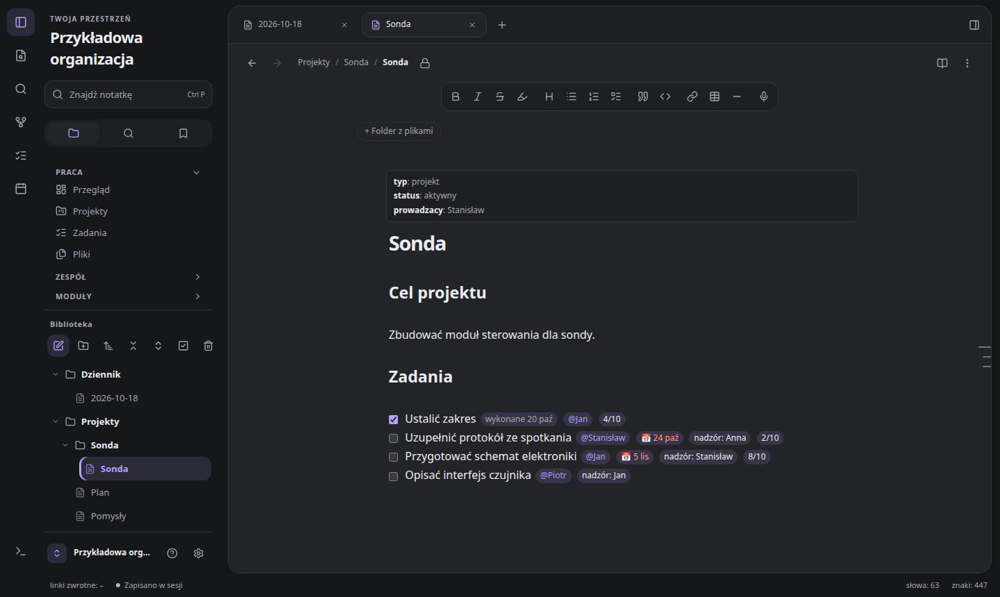

# Tidekey

**Notatki w Markdownie z szyfrowaniem end-to-end: dla Ciebie i dla całego zespołu.**

[](https://github.com/Ludek0303/Tidekey/actions/workflows/ci.yml)
[](LICENSE)


Tidekey (w aplikacji: *Notatki*) to notatnik w stylu Obsidiana: zwykłe pliki `.md`, linki `[[…]]`, tagi, graf
powiązań i podgląd na żywo. Do tego praca zespołowa (zadania, terminy, projekty, kalendarz, uprawnienia), a wszystko
jest szyfrowane na Twoim urządzeniu, zanim trafi na serwer. **Serwer przechowuje i przekazuje dane, ale nie potrafi ich
przeczytać.**

*In English: an Obsidian-style Markdown notes app with end-to-end encryption and team features (tasks, calendar,
projects, permissions). Rust core compiled to WebAssembly, TypeScript UI, self-hosted server, desktop app (Tauri).
Documentation is in Polish. Licensed under AGPL-3.0-or-later.*



> **Projekt jest wciąż rozwijany.** Funkcje, wygląd i formaty danych mogą się jeszcze zmieniać, a część rzeczy z
> listy funkcji jest w budowie ([FUNKCJE.md](docs/FUNKCJE.md)). Przed użyciem z ważnymi danymi rób kopie zapasowe.

## Co potrafi

- **Notatki jak w Obsidianie.** Markdown z podglądem na żywo, `[[wikilinki]]`, odnośniki zwrotne, tagi, graf,
  szablony, notatka dzienna. Notatki zostają zwykłymi plikami `.md`, więc otworzysz je też w Obsidianie.
- **Szyfrowanie end-to-end.** Klucz powstaje z kodu odzyskiwania, który masz tylko Ty. Serwer nie widzi treści,
  tytułów, folderów, załączników ani nazwisk ([co dokładnie widzi serwer](docs/PRZEWODNIK.md#szyfrowanie-co-widzi-serwer)).
- **Wspólne pisanie.** Kilka osób może pisać w jednej notatce naraz; zmiany łączą się same (CRDT), bez konfliktów.
- **Praca zespołowa.** Organizacje z rolami, zadania z osobami, terminami i nadzorem, tablice kanban, projekty
  chronione osobnym kluczem, kalendarze, inwentarze, powiadomienia, aktywność. Każda zmiana jest podpisana.
- **Tabele jak w arkuszu** z formułami (`=SUMA(B2:B9)`), **schematy** rysowane z tekstu, **kalendarz** z
  przypomnieniami i importem `.ics`.
- **Pliki.** Podgląd PDF, dokumentów Office, arkuszy, rysunków CAD (DXF, DWG), modeli 3D i chmur punktów w
  zamkniętej ramce, bez wysyłania pliku do żadnej usługi. Tekst ze skanów i zdjęć (OCR) rozpoznawany na urządzeniu.
- **Dyktowanie po polsku** (i w 24 innych językach): rozpoznawanie mowy w całości w przeglądarce.
- **Claude w Notatkach.** Serwer MCP daje Claude dostęp do wybranych notatek, bez łamania szyfrowania.
- **Trzy sposoby używania:** strona w przeglądarce z własnym serwerem, aplikacja na komputer (Linux, Windows) z
  synchronizacją P2P i demo bez konta.

Pełny opis funkcji, pierwsze kroki i skróty klawiszowe: **[Przewodnik](docs/PRZEWODNIK.md)**.

## Jak to działa

```text
 ┌──────────── Twoje urządzenie ────────────┐          ┌──────── serwer ────────┐
 │ Interfejs (TypeScript, CodeMirror, Yjs)   │          │ notes-node             │
 │   │                                       │ szyfro-  │  • konta i sesje       │
 │   ▼                                       │ gramy    │  • sejfy i role        │
 │ Rdzeń (Rust / WebAssembly)                │ ───────▶ │  • zaszyfrowane kopie  │
 │  • indeks linków, tagów, zadań            │ ◀─────── │  • przekazywanie zmian │
 │  • formuły, kalendarz, Markdown           │          │    na żywo (WebSocket) │
 │  • SZYFROWANIE i podpisy                  │          │  • pliki (zaszyfrowane)│
 └───────────────────────────────────────────┘          └────────────────────────┘
```

- **Notatka to dokument CRDT** (Yjs/Yrs): zmiany z wielu urządzeń łączą się bez nadpisywania.
- **Struktura zostaje zwykłym tekstem.** Zadania, osoby i terminy to krótkie znaczniki w treści (np.
  `@Anna 📅 2026-11-30`), więc działa cofanie, historia wersji i zgodność z Obsidianem.
- Szczegóły: [ARCHITEKTURA.md](docs/ARCHITEKTURA.md) (źródło prawdy projektu) i [SZYFROWANIE.md](docs/SZYFROWANIE.md).

## Szybki start

**Demo bez konta** (wszystko w pamięci karty). Wymagania: Node 22, Rust (`rustup`) i `wasm-pack`
(`cargo install wasm-pack --locked`).

```bash
git clone https://github.com/Ludek0303/Tidekey.git
cd Tidekey/ui
npm ci
npm run wasm     # rdzeń w Ruście → WebAssembly (ui/src/wasm)
npm run dev      # http://localhost:5174/?demo=1
```

`?big=10000` zamiast `?demo=1` generuje 10 000 notatek do sprawdzenia wydajności. Bez parametru strona prosi o
logowanie do serwera `notes-node`.

**Własny serwer** (strona, konta, synchronizacja, pliki) działa w Dockerze: jeden obraz z `notes-node` i gotowym
interfejsem, dane w wolumenie, HTTPS przez Caddy albo Cloudflare Tunnel. Instrukcja: [DOCKER-WEB.md](docs/DOCKER-WEB.md).

```bash
cp .env.example .env          # ustawienia serwera, opis w DOCKER-WEB.md
sudo sh scripts/wdrozenie.sh  # kopia danych, budowa obrazu, uruchomienie
```

> Szyfrowanie w przeglądarce działa tylko na `localhost` albo przez **HTTPS**.

**Aplikacja na komputer:** `./start-app.sh` (Tauri 2, wymaga bibliotek WebKit/GTK systemu).

**Lokalny serwer z kontami do testów:**

```bash
cargo build -p notes-node
(cd ui && npx vite build --outDir /tmp/dist)
./target/debug/notes-node init --data /tmp/dane
AUTH_COOKIE_SECURE=false NOTES_REGISTRATION=open ./target/debug/notes-node serve --data /tmp/dane \
  --http 127.0.0.1:8090 --quic 127.0.0.1:0 --web /tmp/dist --relay off
```

## Testy

```bash
cargo test --workspace
cargo clippy --workspace -- -D warnings
cargo check -p notes-core --target wasm32-unknown-unknown
cd ui && npm test && npm run build
```

CI sprawdza też licencje zależności (`cargo deny`, lista dozwolonych licencji npm), `reuse lint`, aktualność
`THIRD_PARTY_NOTICES.txt` i sekrety (gitleaks).

## Struktura repozytorium

| Katalog | Co zawiera |
|---|---|
| `crates/core` | rdzeń: model danych, CRDT, szyfrowany dziennik zmian, indeks, formuły, kalendarz, kosz |
| `crates/sync` | tożsamość, kod odzyskiwania, certyfikaty urządzeń, uprawnienia, P2P |
| `crates/web` | rdzeń jako WebAssembly dla interfejsu |
| `crates/node` | serwer `notes-node`: konta, sejfy, zaproszenia, synchronizacja, pliki |
| `crates/bridge` | backend aplikacji na komputer |
| `crates/preview` | parsery podglądu plików (WebAssembly) |
| `app/src-tauri` | aplikacja na komputer (Tauri 2) |
| `ui` | interfejs: TypeScript, CodeMirror 6, Yjs, Vite (bez frameworka) |
| `mcp` | serwer MCP dla Claude |
| `docker`, `scripts` | obraz Dockera, wdrożenie, kopie zapasowe, testy w przeglądarce |
| `docs` | dokumentacja (po polsku) |

## Dokumentacja

| Plik | O czym |
|---|---|
| [PRZEWODNIK.md](docs/PRZEWODNIK.md) | jak używać aplikacji: pierwsze kroki, funkcje, zespół, Claude, skróty |
| [FUNKCJE.md](docs/FUNKCJE.md) | lista funkcji i ich stan |
| [ARCHITEKTURA.md](docs/ARCHITEKTURA.md) | jak działa aplikacja, krok po kroku |
| [SZYFROWANIE.md](docs/SZYFROWANIE.md) | klucze, format wiadomości, co widzi serwer |
| [WEB-WSPOLDZIELENIE.md](docs/WEB-WSPOLDZIELENIE.md) | kontrakt serwer ↔ przeglądarka: sejfy, role, projekty chronione |
| [ORGANIZACJA.md](docs/ORGANIZACJA.md) | zadania, osoby, grupy, projekty, powiadomienia |
| [DOCKER-WEB.md](docs/DOCKER-WEB.md) | wdrożenie w Dockerze, HTTPS, konta, kopie zapasowe |
| [MCP-UZYTKOWNIK.md](docs/MCP-UZYTKOWNIK.md) | jak połączyć Claude z Notatkami |
| [RODO.md](docs/RODO.md) | dane osobowe i obowiązki operatora serwera |
| [LICENCJE.md](docs/LICENCJE.md) | licencja projektu i składników innych autorów |

## Licencja

Tidekey jest wolnym oprogramowaniem na licencji **GNU Affero General Public License w wersji 3 lub nowszej**
(`AGPL-3.0-or-later`, plik [LICENSE](LICENSE)). Copyright (c) 2026 Stanisław Ludwicki.

- Możesz używać programu, czytać i zmieniać jego kod oraz udostępniać go dalej, także odpłatnie.
- Kto udostępnia zmienioną wersję, również jako usługę w sieci (np. własny serwer dla innych), musi udostępnić jej
  pełny kod źródłowy na tej samej licencji. Aplikacja pokazuje w Ustawienia → O programie link do kodu wersji, która
  działa.
- Program jest dostarczany bez żadnej gwarancji (szczegóły w licencji).

Licencje bibliotek, modeli i innych składników są w [THIRD_PARTY_NOTICES.txt](THIRD_PARTY_NOTICES.txt) (osobna
sekcja dla każdego artefaktu); jak je odświeżyć i jak dodać zależność: [LICENCJE.md](docs/LICENCJE.md).

**Błędy bezpieczeństwa** zgłaszaj prywatnie, nie w publicznym zgłoszeniu: [SECURITY.md](SECURITY.md).
**Zgłoszenia błędów i pomysły** są mile widziane; zmian w kodzie na razie nie przyjmujemy: [CONTRIBUTING.md](CONTRIBUTING.md).
